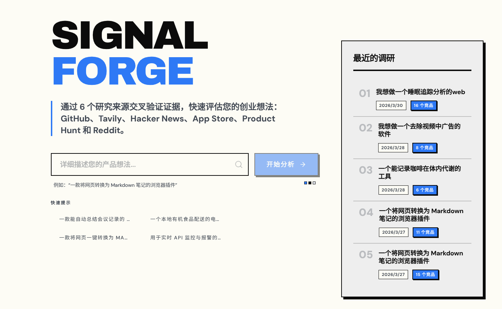
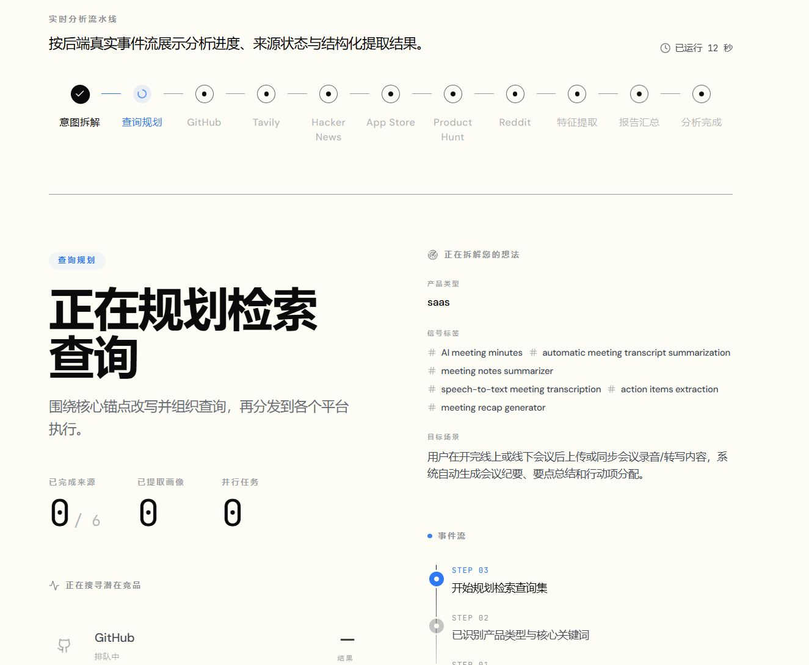
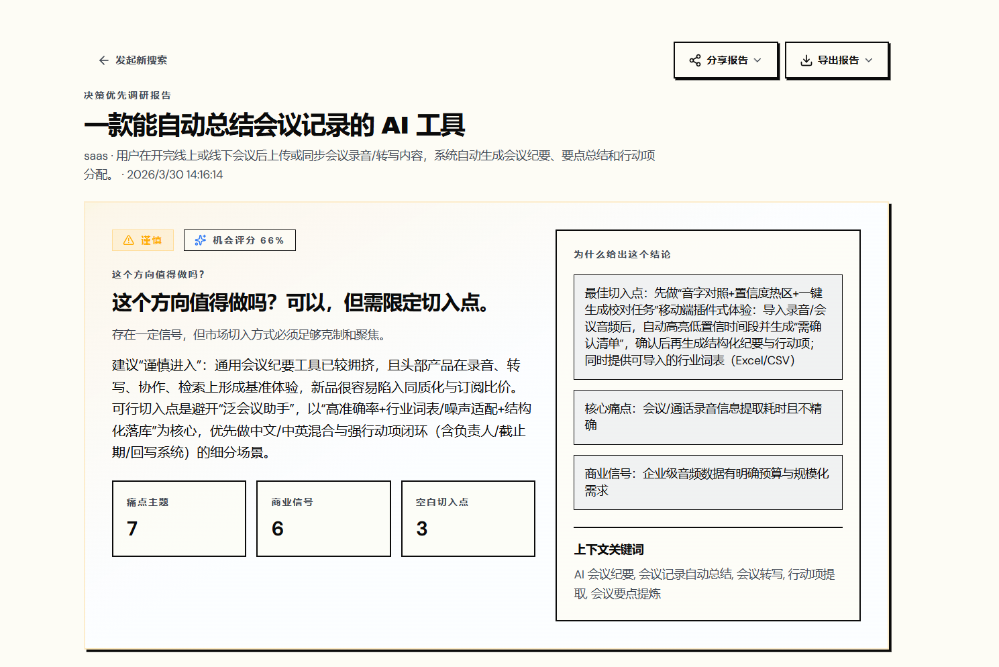
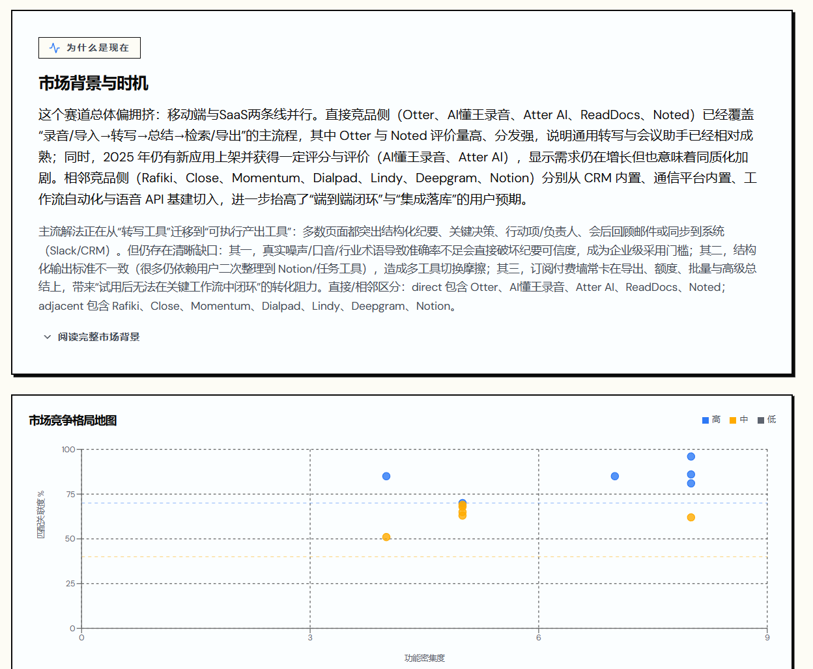
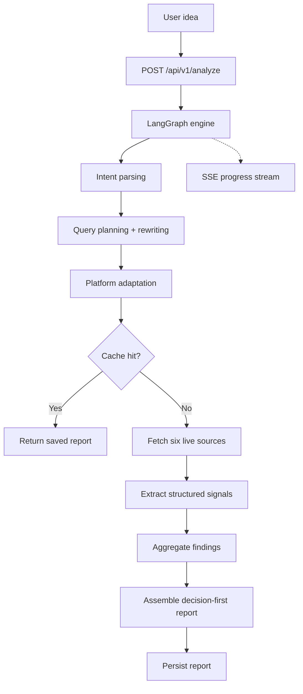

<div align="center">
  

  <h1>SignalForge</h1>

  <p><strong>AI-powered competitor research engine for startup ideas.</strong></p>

  <p>
    SignalForge turns a rough product idea into a structured, evidence-backed validation report:
    recommendation, why-now, pain signals, commercial signals, whitespace opportunities,
    competitors, evidence and confidence.
  </p>

  <p>
    <a href="LICENSE"></a>
    
    
    
    
  </p>
</div>

---

## Features

- **Decision-first reports** — recommendation and why-now up front, followed by pain, commercial, whitespace, competitors, evidence and confidence
- **Six live data sources** — Tavily, Reddit, GitHub, Hacker News, App Store and Product Hunt
- **LangGraph pipeline** with SQLite checkpoints for resumable runs
- **Real-time progress** over Server-Sent Events, with automatic fallback to status polling
- **Report history** with local persistence and Markdown export
- **Anonymous by design** — no login required; stable client session IDs
- **Production safeguards** — per-route rate limiting, Content-Security-Policy headers, Sentry support

## Screenshots

| Idea intake | Research pipeline |
|---|---|
|  |  |
| **Decision summary** | **Competitive landscape** |
|  |  |

## Tech Stack

| Layer | Tools |
|---|---|
| Backend | Python, FastAPI, LangGraph, LangChain, OpenAI SDK, Pydantic |
| Frontend | React 19, TypeScript, Vite, Vitest |
| Data sources | Tavily, Reddit, GitHub, Hacker News, App Store, Product Hunt |
| Tooling | uv, pnpm, Ruff, mypy, pytest, Docker |

## How It Works



| Source | Role |
|---|---|
| Tavily | Broad web recall |
| Reddit | Pain points and switching language |
| GitHub | Open-source maturity and ecosystem |
| Hacker News | Builder sentiment |
| App Store | Review-cluster pain |
| Product Hunt | Launch positioning |

## Quick Start

### Prerequisites

- Python 3.10+ and [uv](https://github.com/astral-sh/uv)
- Node.js 20+ and pnpm
- An `OPENAI_API_KEY` (other source keys are optional but improve coverage)

### Install and configure

```bash
git clone https://github.com/abhisheksen777/SignalForge.git
cd SignalForge
uv sync --all-extras
pnpm --prefix frontend install
cp .env.example .env    # add your API keys
```

Optional keys for better data coverage: `TAVILY_API_KEY`, `GITHUB_TOKEN`, `PRODUCTHUNT_DEV_TOKEN`, `REDDIT_CLIENT_ID`, `REDDIT_CLIENT_SECRET`.

### Run in development

```bash
# Terminal 1 – backend
uv run uvicorn signalforge.api.app:create_app --factory --reload --port 8000

# Terminal 2 – frontend
pnpm --prefix frontend dev
```

Open http://localhost:5173.

### Single-process run

```bash
pnpm --prefix frontend build
uv run python -m signalforge
```

Open http://localhost:8000.

### Docker

```bash
docker compose up -d --build
```

See [DEPLOYMENT.md](DEPLOYMENT.md) for production deployment.

## API

| Method | Endpoint | Description |
|---|---|---|
| POST | `/api/v1/analyze` | Start analysis of an idea |
| GET | `/api/v1/reports` | List reports |
| GET | `/api/v1/reports/{id}` | Report detail |
| GET | `/api/v1/reports/{id}/status` | Run status |
| GET | `/api/v1/reports/{id}/stream` | SSE progress stream |
| GET | `/api/v1/reports/{id}/export` | Markdown export |
| DELETE | `/api/v1/reports/{id}` | Delete report |
| DELETE | `/api/v1/reports/{id}/cancel` | Cancel a running analysis |
| GET | `/api/v1/health` | Health check |

## Project Structure

```
src/signalforge/
├── api/          # FastAPI app, routes, middleware
├── cache/        # Report persistence
├── config/       # Settings
├── models/       # Domain models and report contracts
├── pipeline/     # Orchestration, extraction, aggregation
└── sources/      # Data-source adapters
frontend/src/
├── app/          # Router and shell
├── features/     # home, history, reports
└── lib/          # API client, SSE hook, i18n
```

## Testing

```bash
uv run ruff check src tests
uv run mypy src
uv run pytest
pnpm --prefix frontend lint
pnpm --prefix frontend test
```

## Author

**Abhishek Sen** — [@abhisheksen777](https://github.com/abhisheksen777)

## License

Released under the MIT License. See [LICENSE](LICENSE).
